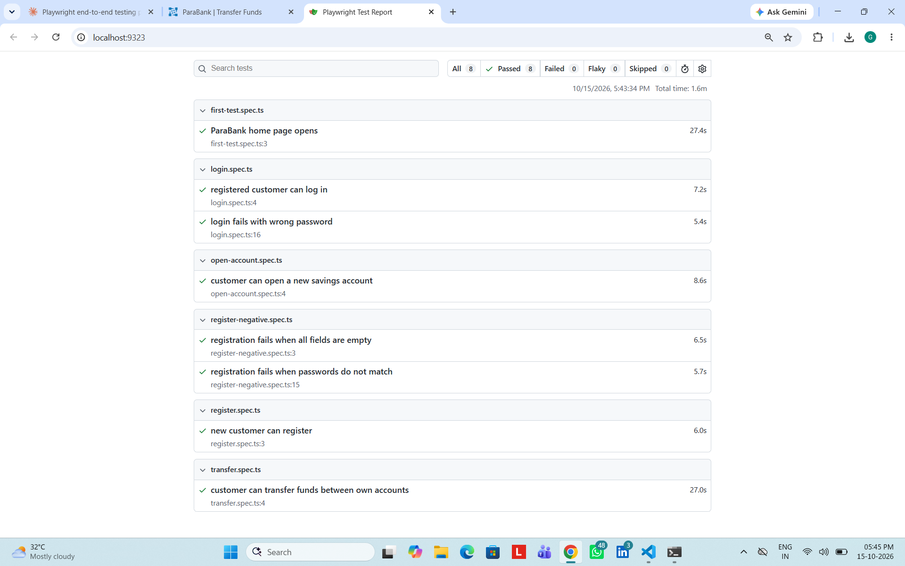

# ParaBank Playwright E2E Tests


End-to-end test automation for an online banking web app, built with **Playwright** and **TypeScript**.

The app under test is [ParaBank](https://parabank.parasoft.com), a public demo bank by Parasoft. The tests cover the main customer journeys: registration, login, opening an account and transferring funds.

## What is tested

| Area | Test file | Scenario |
|---|---|---|
| Smoke | `first-test.spec.ts` | Home page loads and the login form is visible |
| Registration | `register.spec.ts` | A new customer can register |
| Registration (negative) | `register-negative.spec.ts` | Empty form and mismatched passwords are rejected |
| Login | `login.spec.ts` | A registered customer can log in; a wrong password is rejected |
| Accounts | `open-account.spec.ts` | A customer can open a new savings account |
| Payments | `transfer.spec.ts` | A customer can transfer funds between their own accounts and the amount is verified |

## Tech stack

- Playwright Test
- TypeScript
- Node.js

## Project structure

```
tests/      test files (one per feature)
utils/      reusable helper functions (for example, registering a new user)
docs/       report screenshot
playwright.config.ts   test settings
```

## How to run

You need Node.js 18 or newer.

```bash
git clone https://github.com/gowshalya11feb-dev/parabank-playwright-e2e.git
cd parabank-playwright-e2e
npm install
npx playwright install
npm test
```

Open the HTML report after a run:

```bash
npm run report
```

## Test report



## Key practices used

- **Independent tests:** each test creates its own customer with a unique username, so tests never depend on each other.
- **Reusable helper:** the registration steps live in one function (`utils/helpers.ts`) instead of being copied into every test.
- **Positive and negative testing:** tests check that valid input works and that invalid input is rejected.
- **Value checks:** the transfer test verifies the exact amount reported by the bank, not just a success message.
- **Stable locators:** elements are found by role, label or id, as recommended by Playwright.
- **Failure evidence:** screenshots are captured on failure and an HTML report is generated.

## Notes

ParaBank is a shared public demo site, so it can occasionally be slow. The config uses longer timeouts and one retry to handle that.